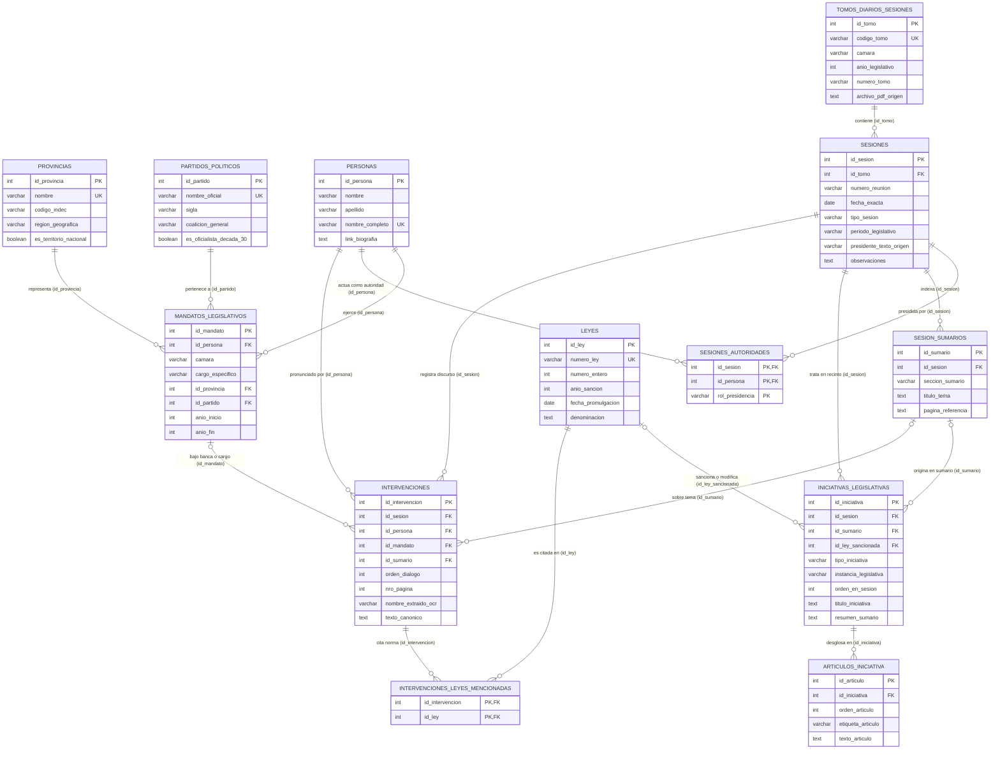

# El Giro en la Política Comercial Argentina entre Crisis (1929–1939)

<div align="center">

[](https://www.python.org/)
[](https://www.unsam.edu.ar/)
[](https://iip.unsam.edu.ar/)
[](https://supabase.com/)
[](https://plotly.com/)

**Análisis de datos textuales, procesamiento de lenguaje natural y visualización interactiva sobre los debates del Congreso Nacional Argentino durante la década de 1930.**

</div>

---

## 📌 Contexto del Proyecto

* **Institución**: Universidad Nacional de San Martín (UNSAM) — Escuela de Ciencia y Tecnología (ECyT).
* **Marco de Investigación**: Instituto de Investigaciones Políticas (EPyG-UNSAM / CONICET).
* **Estudiante**: Lucas Barreiro ([lebarreiro@estudiantes.unsam.edu.ar](mailto:lebarreiro@estudiantes.unsam.edu.ar)).
* **Directora de Investigación**: Dra. Agustina Rayes (Investigadora Independiente CONICET / UNSAM).
* **Tutores Académicos**: Fabiana Taboada y Pablo Serrati.

---

## 🎯 Objetivo General

Estudiar los debates del Congreso Nacional Argentino vinculados a la política comercial exterior entre el inicio de la Gran Depresión (1929) y el estallido de la Segunda Guerra Mundial (1939). A través de técnicas de Ciencia de Datos y Procesamiento de Lenguaje Natural (NLP), se busca estructurar las fuentes documentales para analizar la participación por provincias, fuerzas políticas e instituciones de gobierno.

---

## 🔬 Metodología de Trabajo

1. **Extracción y Estructuración Documental (3NF)**:
   Procesamiento de los 209 tomos de actas taquigráficas históricas en formato PDF (diseño tradicional a doble columna), desagregando las **1.282 sesiones parlamentarias individuales** con su fecha exacta (`YYYY-MM-DD`), separando oradores, cámara (Diputados y Senadores), ministros del Poder Ejecutivo y representación distrital bajo un modelo relacional estricto en **Tercera Forma Normal (3NF)**.

2. **Curaduría de Texto con Asistencia de IA**:
   Tratamiento de roturas de palabras y errores propios del escaneo y OCR histórico mediante modelos de lenguaje y heurísticas de expresión regular, preservando tanto el texto canónico curado como las versiones alternativas de procesamiento.

3. **Reconocimiento de Entidades Nombradas (NER) y Postura Ideológica (ABSA)**:
   Detección automatizada de instituciones económicas oficiales y corporativas (BCRA, Juntas Reguladoras, SRA, UIA, CAC, CARBAP, FAA), socios comerciales (Reino Unido, Estados Unidos, Alemania) y tratados (Pacto Roca-Runciman, Conferencia de Ottawa), evaluando la polaridad y postura argumentativa (*Aspect-Based Sentiment Analysis*) de cada intervención.

4. **Análisis Exploratorio y Ponderación Per Cápita**:
   Evaluación de la participación parlamentaria tanto en términos absolutos como ponderada por el número de bancas asignadas constitucionalmente a cada provincia, visualizada en series de tiempo y mapas coropléticos interactivos.

5. **Modelado de Tópicos (Topic Modeling)**:
   Aplicación de modelos de tópicos guiados para identificar los grandes ejes de discusión comercial (aranceles, tratados bilaterales, régimen cambiario y producción agropecuaria) y contrastar la prevalencia temática del Poder Ejecutivo frente a las cámaras legislativas.

---

## 🗄️ Estructura de la Base de Datos en Supabase

La base de datos en **Supabase (PostgreSQL)** está organizada en **Tercera Forma Normal (3NF)** a través de **13 tablas** distribuidas en **5 subsistemas** (catálogos invariantes, estructura institucional, publicaciones y sesiones, normas y proyectos, y debate parlamentario). Por su parte, el Reconocimiento de Entidades Nombradas (NER) y la generación del dashboard interactivo operan como un módulo analítico independiente en Python sobre los datos de estas tablas.

---

### Diagrama Entidad-Relación (DER)



---

### Detalle de las 13 Tablas de la Base de Datos en Supabase

| # | Subsistema | Tabla en Supabase (`public`) | Clave Primaria (PK) | Claves Foráneas (FK) | Registros Verificados | Propósito en la Base de Datos |
| :-: | :--- | :--- | :--- | :--- | --: | :--- |
| **01** | **1. Catálogos** | `provincias` | `id_provincia` | — | **15** | Provincias históricas y Capital Federal normalizadas con código INDEC y región geográfica. |
| **02** | **1. Catálogos** | `partidos_politicos` | `id_partido` | — | **25** | Fuerzas políticas unificadas de la década de 1930, sigla y mapeo a coalición (`Concordancia`, `UCR`, `PS`, etc.). |
| **03** | **1. Catálogos** | `personas` | `id_persona` | — | **586** | Padrón depurado de personas físicas (legisladores, ministros del PE y autoridades de cámara). |
| **04** | **2. Institucional** | `mandatos_legislativos` | `id_mandato` | `id_persona`, `id_provincia`, `id_partido` | **744** | Bancas y cargos temporales ejercidos por cada persona (`camara`, `cargo_especifico`, `anio_inicio`, `anio_fin`). |
| **05** | **3. Sesiones** | `tomos_diarios_sesiones` | `id_tomo` | — | **209** | Volúmenes físicos/PDF de los *Diarios de Sesiones* (`1929` a `1939`). |
| **06** | **3. Sesiones** | `sesiones` | `id_sesion` | `id_tomo` | **1.282** | Reuniones parlamentarias individuales extraídas de los PDFs con su `fecha_exacta` (`YYYY-MM-DD`). |
| **07** | **3. Sesiones** | `sesiones_autoridades` | `(id_sesion, id_persona, rol_presidencia)` | `id_sesion`, `id_persona` | **1.276** | Autoridades que presidieron cada sesión parlamentaria. |
| **08** | **3. Sesiones** | `sesion_sumarios` | `id_sumario` | `id_sesion` | **7.469** | Entradas del índice/sumario temático de cada sesión vinculadas a su reunión. |
| **09** | **4. Normas y Proyectos** | `leyes` | `id_ley` | — | **2.136** | Catálogo de leyes nacionales: las **1.087 leyes sancionadas en 1929–1939** (`11.544` a `12.630`) + **1.049 leyes históricas pre-1929** (`48` a `11.543`). |
| **10** | **4. Normas y Proyectos** | `iniciativas_legislativas` | `id_iniciativa` | `id_sesion`, `id_ley_sancionada` | **9.669** | Cabecera deduplicada de proyectos de ley, despachos en recinto y las 1.087 leyes sancionadas. |
| **11** | **4. Normas y Proyectos** | `articulos_iniciativa` | `id_articulo` | `id_iniciativa` | **50.329** | Desglose individual artículo por artículo (`Art. 1°`, `Art. 2°`, etc.) de cada iniciativa y ley sancionada. |
| **12** | **5. Debate Parlamentario** | `intervenciones` | `id_intervencion` | `id_sesion`, `id_persona`, `id_mandato`, `id_sumario` | **64.636** | Universo completo de intervenciones parlamentarias vinculadas a su sesión, página, fecha exacta y orador. |
| **13** | **5. Debate Parlamentario** | `intervenciones_leyes_mencionadas` | `(id_intervencion, id_ley)` | `id_intervencion`, `id_ley` | **8.563** | Tabla puente que registra cada ley nacional citada dentro de una intervención. |

---

## 📂 Estructura del Repositorio

A continuación se detalla la organización limpia y modular del repositorio:

```text
├── base_de_datos/
│   ├── database_connection.py            # Cliente de conexión centralizada a Supabase
│   └── schema_supabase.dbml              # Definición del esquema relacional en 3NF (DBML)
├── extractores/
│   ├── extractor_fechas_sesiones.py      # Extractor de las 1.282 sesiones y fechas exactas en los 209 tomos
│   ├── extractor_intervenciones.py       # Extractor de discursos a doble columna y cruce difuso de oradores
│   ├── extractor_provincias.py           # Extractor del padrón de legisladores y distritos provinciales
│   └── extractor_sumarios_leyes.py       # Extractor de sumarios temáticos, proyectos y las 1.087 leyes
├── curacion_intervenciones/
│   └── curador_ia.py                     # Curaduría asincrónica de discursos mediante IA (OpenAI)
├── analisis_ner/
│   └── motor_ner.py                      # Motor de Reconocimiento de Entidades (NER) y ABSA
├── Creacion_graficos/
│   ├── graficos/                         # Visualizaciones interactivas en HTML (Plotly y Dashboards)
│   │   ├── animado_partidos_int_abs.html
│   │   ├── animado_partidos_pal_abs.html
│   │   ├── animado_provincias_diputados_per_capita_ints.html
│   │   ├── animado_provincias_diputados_per_capita_pals.html
│   │   ├── animado_provincias_senadores_int_abs.html
│   │   ├── animado_provincias_senadores_pal_abs.html
│   │   ├── composicion_activa_diputados.html
│   │   ├── composicion_activa_senadores.html
│   │   ├── dashboard_roca_runciman_ner.html
│   │   ├── evolucion_partidaria_1929_1939.html
│   │   ├── mapa_provincias_diputados_per_capita.html
│   │   ├── mapa_provincias_senadores.html
│   │   ├── porcentaje_provincias_diputados_per_capita.html
│   │   ├── porcentaje_provincias_diputados_ratio.html
│   │   ├── porcentaje_provincias_senadores.html
│   │   └── volumen_total_intervenciones.html
│   ├── bancas_diputados.py               # Ponderación por bancas históricas y consultas a Supabase 3NF
│   ├── eda_provincias.py                 # Análisis exploratorio provincial (absoluto y per cápita)
│   ├── eda_provincias_porcentaje.py      # Participación provincial en términos proporcionales
│   ├── evolucion_composicion.py          # Legisladores activos por partido en ambas cámaras
│   ├── evolucion_partidaria.py           # Dinámica temporal de las bancadas partidarias
│   ├── generar_dashboard_ner.py          # Generador del Dashboard interactivo NER y tabla documental
│   ├── interv_totales.py                 # Cálculo de totales y agregados del corpus
│   ├── mapa_interactivo.py               # Mapas coropléticos de la Argentina con slider temporal
│   └── provincias.geojson                # Geometrías oficiales de las provincias argentinas (IGN)
├── requirements.txt                      # Dependencias del proyecto en Python
├── .env.example                          # Plantilla de variables de entorno requeridas
├── .gitignore                            # Reglas de exclusión de git
└── README.md                             # Documentación metodológica y técnica del repositorio
```

---

## 🛠️ Requisitos e Instalación

### Requisitos Previos
* Python 3.10 o superior.
* Git.

### Configuración del Entorno

```bash
# Clonar el repositorio
git clone https://github.com/lucasbarreiroe/PoliticaComercialArgentina_1929-1939.git
cd PoliticaComercialArgentina_1929-1939

# Crear y activar entorno virtual
python -m venv venv

# En Windows PowerShell:
.\venv\Scripts\Activate.ps1
# En Linux/macOS:
source venv/bin/activate

# Instalar dependencias
pip install -r requirements.txt
```

### Variables de Entorno (`.env`)
Copiar la plantilla de ejemplo y completar las credenciales correspondientes:

```bash
# En Windows PowerShell:
Copy-Item .env.example .env
# En Linux/macOS:
cp .env.example .env
```

Contenido requerido en `.env`:
```env
SUPABASE_URL=https://tu-proyecto.supabase.co
SUPABASE_KEY=tu-clave-anon-o-service-role
OPENAI_API_KEY=tu-api-key-de-openai   # Opcional para curador_ia.py
```

### Ejecución del Motor NER y Generación de Gráficos
```bash
# Ejecutar el motor NER y ABSA directamente sobre las tablas 3NF
python analisis_ner/motor_ner.py --lote 1000

# Generar el Dashboard interactivo NER unificado
python Creacion_graficos/generar_dashboard_ner.py
```

---

## 📊 Visualizaciones y Resultados

Todas las visualizaciones son documentos HTML autocontenidos generados con Plotly que pueden descargarse o abrirse directamente en cualquier navegador web:

### 🌐 Dashboard Analítico Interactivo
* [**Dashboard Roca-Runciman y Entidades de Política Comercial**](Creacion_graficos/graficos/dashboard_roca_runciman_ner.html): Panel unificado con métricas clave, filtros interactivos en vivo (año, provincia, partido político, ley tratada, palabra clave) y tabla documental de discursos.

### 🗺️ Cartografía Parlamentaria Per Cápita
* [**Mapa de Diputados (Intervenciones per cápita)**](Creacion_graficos/graficos/mapa_provincias_diputados_per_capita.html): Actividad provincial ponderada por las 158 bancas históricas, con slider temporal y marcador interactivo para CABA.
* [**Mapa del Senado (Intervenciones por provincia)**](Creacion_graficos/graficos/mapa_provincias_senadores.html): Nivel de debate en el Senado bajo la distribución federal paritaria (2 senadores por provincia).

### 📈 Dinámica Partidaria y Composición de Cámaras
* [**Evolución Partidaria 1929–1939**](Creacion_graficos/graficos/evolucion_partidaria_1929_1939.html): Top 10 de fuerzas políticas por volumen de intervenciones a lo largo de la década.
* [**Composición Activa en Diputados**](Creacion_graficos/graficos/composicion_activa_diputados.html): Cantidad anual de diputados con uso efectivo de la palabra por bancada política.
* [**Composición Activa en el Senado**](Creacion_graficos/graficos/composicion_activa_senadores.html): Senadores activos por partido político entre 1929 y 1939.

### 📊 Análisis Exploratorio Provincial y Partidario (EDA)
* [**Partidos: Intervenciones por año (Absoluto)**](Creacion_graficos/graficos/animado_partidos_int_abs.html)
* [**Partidos: Volumen de palabras por año (Absoluto)**](Creacion_graficos/graficos/animado_partidos_pal_abs.html)
* [**Diputados: Intervenciones per cápita por provincia**](Creacion_graficos/graficos/animado_provincias_diputados_per_capita_ints.html)
* [**Diputados: Volumen de palabras per cápita por provincia**](Creacion_graficos/graficos/animado_provincias_diputados_per_capita_pals.html)
* [**Senado: Intervenciones por provincia por año**](Creacion_graficos/graficos/animado_provincias_senadores_int_abs.html)
* [**Senado: Palabras por provincia por año**](Creacion_graficos/graficos/animado_provincias_senadores_pal_abs.html)
* [**Porcentajes Provinciales en Diputados**](Creacion_graficos/graficos/porcentaje_provincias_diputados_per_capita.html)
* [**Ratio de Intensidad Discursiva en Diputados**](Creacion_graficos/graficos/porcentaje_provincias_diputados_ratio.html)
* [**Porcentajes Provinciales en el Senado**](Creacion_graficos/graficos/porcentaje_provincias_senadores.html)
* [**Volumen Total de Intervenciones**](Creacion_graficos/graficos/volumen_total_intervenciones.html)

---

## 📖 Fuentes de Datos

Los debates parlamentarios corresponden a transcripciones de acceso público de la **Biblioteca del Congreso de la Nación (BCN)**, digitalizadas con fines educativos, de divulgación e investigación histórica.

---

## ✉️ Contacto

* **Lucas Barreiro** — [lebarreiro@estudiantes.unsam.edu.ar](mailto:lebarreiro@estudiantes.unsam.edu.ar)
* **Dra. Agustina Rayes** — [arayes@unsam.edu.ar](mailto:arayes@unsam.edu.ar)
