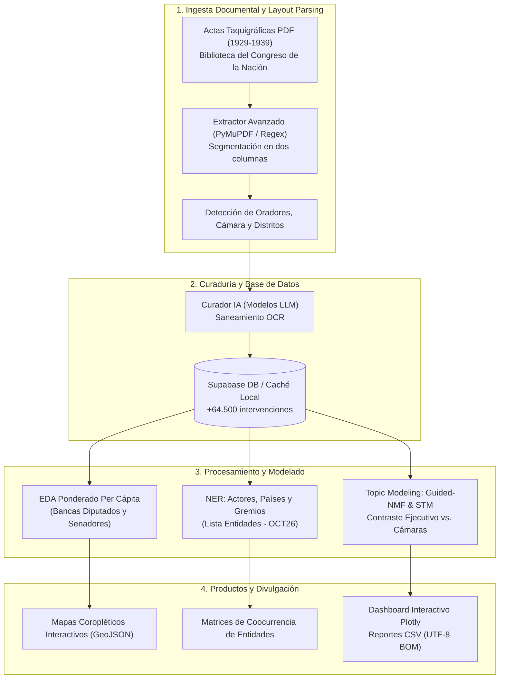

# El Giro en la Política Comercial Argentina entre Crisis (1929–1939)

<div align="center">

[](https://www.python.org/)
[](https://www.unsam.edu.ar/)
[](https://iip.unsam.edu.ar/)
[](https://supabase.com/)
[](https://plotly.com/)
[](#licencia-y-fuentes)

**Minería de Textos, Inteligencia Artificial y Modelado de Tópicos aplicados a los Debates del Congreso Nacional Argentino (1929–1939)**

</div>

---

## 📌 Contexto Institucional y Académico

Este repositorio alberga el código, los pipelines de extracción, el procesamiento de lenguaje natural (NLP) y las visualizaciones interactivas correspondientes al proyecto de investigación:

* **Proyecto**: *El giro en la política comercial argentina entre crisis, 1929–1939*
* **Unidad Académica**: Licenciatura en Ciencia de Datos — Escuela de Ciencia y Tecnología (ECyT), Universidad Nacional de San Martín (UNSAM).
* **Marco Institucional**: Instituto de Investigaciones Políticas (IIP, Escuela de Política y Gobierno — UNSAM / CONICET).
* **Tesista / Autor**: Lucas Barreiro ([lebarreiro@estudiantes.unsam.edu.ar](mailto:lebarreiro@estudiantes.unsam.edu.ar))
* **Directora de Investigación**: Dra. Agustina Rayes (Investigadora Independiente CONICET / Profesora Adjunta UNSAM).
* **Tutores Académicos**: Fabiana Taboada y Pablo Serrati.

---

## 🎯 Pregunta de Investigación y Objetivos

### Pregunta Central
> *¿Cuáles fueron los principales temas discutidos, las posturas de los partidos políticos y provincias, y los intereses privados que incidieron en la construcción de la política comercial argentina debatida en el Congreso Nacional entre la Gran Depresión (1929) y el estallido de la Segunda Guerra Mundial (1939)?*

### Objetivos Específicos
1. **Extracción y Estructuración**: Transformar actas taquigráficas escaneadas en PDF (diseño a dos columnas) en una base de datos histórica relacional, discriminando oradores, cámara (Diputados y Senadores), ministros del Poder Ejecutivo, partidos políticos y distritos provinciales.
2. **Curaduría y Saneamiento con IA**: Emplear modelos LLM para la corrección gramatical y contextual de textos degradados por OCR histórico, preservando la fidelidad discursiva original.
3. **Análisis Exploratorio de Datos (EDA)**: Medir la participación parlamentaria (absoluta, relativa y **ponderada per cápita** por número de bancas asignadas a cada provincia).
4. **Reconocimiento de Entidades Nombradas (NER)**: Identificar actores públicos, países socios (Reino Unido, EE.UU., Alemania), corporaciones privadas (frigoríficos Swift, Armour, Anglo) y corporaciones gremiales (Sociedad Rural Argentina, CARBAP).
5. **Modelado de Tópicos y Contraste Institucional (Topic Modeling / STM)**: Modelar los ejes de debate (Guided-NMF / LDA) para contrastar estadísticamente las narrativas oficiales del Poder Ejecutivo frente a las de las Cámaras legislativas en coyunturas críticas (Pacto Roca-Runciman, creación del Banco Central, Juntas Reguladoras y control de cambios).
6. **Visualización y Comunicación Científica**: Desarrollar mapas coropléticos interactivos (GeoJSON) y tableros interactivos para la publicación científica y web.

---

## 🏗️ Arquitectura del Sistema



---

## 📦 Módulos Principales

### 1. Ingesta y Estructuración de Debates
* **[`extractor_avanzado.py`](extractor_avanzado.py)**: Algoritmo de *Document Layout Analysis* que segmenta bloques de texto en doble columna horizontal y vertical, detectando saltos de página y líneas de orador.
* **[`extractor_provincias.py`](extractor_provincias.py)**: Normalizador geográfico que asigna procedencia provincial a cada legislador según actas y nóminas oficiales.
* **[`Extractor_sumarios_leyes.py`](Extractor_sumarios_leyes.py)**: Extractor de sumarios, títulos y articulados de leyes comerciales promulgadas o debatidas.
* **[`database_connection.py`](database_connection.py)**: Capa de persistencia y consultas relacionales sobre Supabase PostgreSQL.

### 2. Curaduría y Corrección de Texto Asistida por IA
* **[`curador_ia_gemini.py`](curador_ia_gemini.py)** y **[`Arreglo_intervenciones/`](Arreglo_intervenciones/)**: Pipelines orientados a solventar roturas de palabras por guionado histórico, erratas de tipografía y oraciones fragmentadas.
* **[`cazador_delirios.py`](cazador_delirios.py)**: Script de control de calidad para auditar que el post-procesado no introduzca alucinaciones ni altere el contenido fáctico.
* **[`corrector_diputados.py`](corrector_diputados.py)** y **[`corrector_intervenciones.py`](corrector_intervenciones.py)**: Unificación ontológica de nombres, cargos y partidos.

### 3. Análisis Exploratorio y Ponderación Per Cápita (`Creacion_graficos/`)
* **[`bancas_diputados.py`](Creacion_graficos/bancas_diputados.py)**: Mapeo de la asignación constitucional de bancas de Diputados por provincia entre 1929 y 1939.
* **Métricas Ponderadas**: Para evitar el sesgo de sobredimensionamiento de provincias grandes (ej. Buenos Aires y Capital Federal), se crearon métricas de **intervenciones y palabras per cápita parlamentaria** ($\frac{\text{Intervenciones}}{\text{Bancas}}$).
* **[`mapa_interactivo.py`](Creacion_graficos/mapa_interactivo.py)**: Generador de mapas coropléticos sobre [`provincias.geojson`](Creacion_graficos/provincias.geojson).
* **Visualizaciones Interactivas**: Animaciones y gráficos temporales Plotly en `Creacion_graficos/graficos/`:
  - `mapa_provincias_diputados_per_capita.html` / `mapa_provincias_senadores.html`
  - `porcentaje_provincias_diputados_per_capita.html`
  - `animado_partidos_int_abs.html` / `animado_partidos_relativo.html`
  - `evolucion_partidaria_1929_1939.html`
  - `volumen_total_intervenciones.html`

### 4. Reconocimiento de Entidades Nombradas (`NER.py`)
* Pipeline de extracción de entidades políticas, mercantiles y agropecuarias basado en la taxonomía histórica [`Lista Entidades - OCT26.pdf`](Lista%20Entidades%20-%20OCT26.pdf).
* Reconoce actores como la **Sociedad Rural Argentina (SRA)**, **CARBAP**, frigoríficos internacionales (**Swift**, **Armour**, **Anglo**, **Smithfield**), socios bilaterales y ministros de hacienda/agricultura.

### 5. Topic Modeling y Contraste Institucional (`Topic_Modeling.py`)
Módulo autocontenido de modelado temático estructurado (*Structural Topic Models / Guided-NMF*):
* **Ingesta Dual**: Lee indistintamente de la base de datos/caché o directamente de archivos PDF parlamentarios (`--pdf` para un archivo o `--pdf-dir` para carpetas sincronizadas de Google Drive).
* **Preprocesamiento Avanzado**: Remoción de fórmulas parlamentarias de la época y vectorización TF-IDF con n-gramas (1 y 2).
* **Contraste Empírico Oficialismo vs. Oposición**:
  - Compara la prevalencia de los **Ministros del Poder Ejecutivo** frente a **Diputados y Senadores**.
  - Evalúa hipótesis mediante el estadístico $t$ de Welch y regresiones multivariadas MCO (*OLS*).
* **Foco Especial: Debate del Pacto Roca-Runciman (1933–1935)**:
  - Revela que el Poder Ejecutivo centró su discurso con significancia estadística ($p < 0.01$) en el **Control de Cambios y Divisas** (+11.45% de brecha frente a las Cámaras) para respaldar la transferencia de remesas al Reino Unido y el servicio de la deuda externa.
  - Las Cámaras retuvieron la agenda fiscal crítica y la investigación del **Monopolio de los Frigoríficos**.
* **Entregables**: Exporta 6 datasets CSV (UTF-8 BOM) y el [Dashboard Interactivo Plotly](Creacion_graficos/graficos/dashboard_topic_modeling.html).

---

## 📂 Estructura del Repositorio

```text
├── Creacion_graficos/                # Visualizaciones, mapas coropléticos y tableros
│   ├── graficos/                     # Gráficos interactivos generados en HTML (Plotly)
│   │   ├── dashboard_topic_modeling.html
│   │   ├── mapa_provincias_diputados_per_capita.html
│   │   ├── evolucion_partidaria_1929_1939.html
│   │   └── ...
│   ├── bancas_diputados.py           # Diccionario histórico de bancas por distrito
│   ├── eda_provincias.py             # EDA provincial absoluto y relativo
│   ├── eda_provincias_porcentaje.py  # EDA en ratios normalizados
│   ├── evolucion_partidaria.py       # Dinámica partidaria temporal
│   ├── mapa_interactivo.py           # Construcción de mapas coropléticos
│   └── provincias.geojson            # Geometrías de las provincias argentinas
├── Arreglo_intervenciones/           # Scripts de curaduría y saneamiento de texto
├── Topic_Modeling.py                 # Motor integral de Topic Modeling y Contraste STM
├── NER.py                            # Extracción de Entidades Nombradas (actores y gremios)
├── Extractor_sumarios_leyes.py       # Extracción y estructuración de leyes históricas
├── extractor_avanzado.py             # Parser PDF de actas taquigráficas a dos columnas
├── extractor_provincias.py           # Mapeo de oradores a provincias
├── curador_ia_gemini.py              # Corrección de OCR mediante LLM
├── cazador_delirios.py               # Auditoría de alucinaciones y control de calidad
├── database_connection.py            # Módulo de conexión y queries a Supabase
├── Plan de Trabajo - Lucas Barreiro.pdf # Plan de trabajo formal aprobado por UNSAM
├── Lista Entidades - OCT26.pdf       # Taxonomía de entidades para NER
└── README.md                         # Documentación oficial del proyecto
```

---

## 🚀 Instalación y Requisitos

### Requisitos Previos
* **Python**: Versión 3.10 o superior (recomendada 3.11).
* **Git**: Para clonar y gestionar el repositorio.

### Configuración del Entorno Virtual

```bash
# Clonar el repositorio
git clone https://github.com/lucasbarreiroe/PoliticaComercialArgentina_1929-1939.git
cd PoliticaComercialArgentina_1929-1939

# Crear y activar entorno virtual
python -m venv venv

# En Windows PowerShell:
.\venv\Scripts\Activate.ps1
# En Linux/macOS:
source venv/bin/activate

# Instalar dependencias esenciales
pip install numpy pandas scikit-learn scipy statsmodels pymupdf plotly supabase python-dotenv
```

### Variables de Entorno (`.env`)
Para conectarse a la base de datos de Supabase o utilizar servicios de curaduría asistida, configure en la raíz un archivo `.env`:

```env
SUPABASE_URL=https://tu-proyecto.supabase.co
SUPABASE_KEY=tu-clave-anon-o-service-role
GEMINI_API_KEY=tu-api-key-de-google-ai  # Opcional para curador_ia
```

---

## 💻 Guía de Uso Rápido

### 1. Ejecutar el Topic Modeling y Contraste Institucional

```bash
# Modelado guiado sobre el subcorpus de política comercial (8 tópicos clave)
python Topic_Modeling.py --foco politica_comercial --num-topicos 8

# Modelado sobre el corpus parlamentario completo (10 tópicos)
python Topic_Modeling.py --foco todo --num-topicos 10

# Ingesta y modelado directo desde un tomo en PDF local
python Topic_Modeling.py --pdf CS_1937_TII.pdf --num-topicos 6

# Ingesta masiva desde una carpeta de Google Drive sincronizada con PDFs
python Topic_Modeling.py --pdf-dir "C:/Ruta/A/Carpeta_Drive_PDFs" --num-topicos 8
```

Los resultados se guardan automáticamente en:
* `topic_modeling_resumen_topicos.csv`
* `topic_modeling_contraste_oficial_vs_camaras.csv`
* `topic_modeling_roca_runciman_foco.csv`
* `topic_modeling_partidos_y_topicos.csv`
* `topic_modeling_evolucion_temporal_1929_1939.csv`
* `topic_modeling_documentos_clasificados.csv`
* `Creacion_graficos/graficos/dashboard_topic_modeling.html`

### 2. Generar Mapas y Visualizaciones Ponderadas

```bash
# Generar mapas coropléticos de participación provincial ponderada per cápita
python Creacion_graficos/mapa_interactivo.py

# Generar gráficos de evolución partidaria interactivos
python Creacion_graficos/evolucion_partidaria.py
```

Las figuras resultantes en formato HTML interactivo quedan listas para ser abiertas en cualquier navegador web o incrustadas en portales de divulgación.

---

## 🔒 Licencia y Fuentes Históricas

* **Fuentes Históricas**: Las transcripciones de las sesiones del Congreso Nacional pertenecen al dominio público y fueron digitalizadas por la [Biblioteca del Congreso de la Nación (BCN)](https://bcn.gob.ar/). Al tratarse de documentación histórica de carácter público, no se vulneran datos sensibles ni derechos de privacidad.
* **Uso Académico**: El código y los datos procesados están destinados a fines de investigación académica, docencia y producción científica interdisciplinaria.

---

## ✉️ Contacto

* **Lucas Barreiro** — Escuela de Ciencia y Tecnología (UNSAM)  
  Correo: [lebarreiro@estudiantes.unsam.edu.ar](mailto:lebarreiro@estudiantes.unsam.edu.ar)
* **Dra. Agustina Rayes** — IIP (EPyG-UNSAM / CONICET)  
  Correo: [arayes@unsam.edu.ar](mailto:arayes@unsam.edu.ar)
