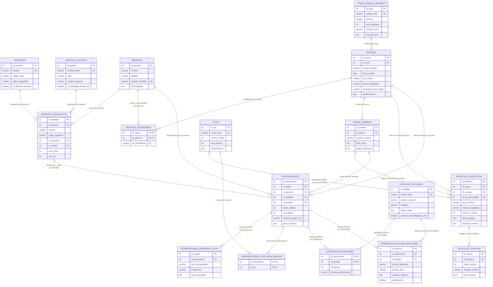

# El Giro en la Política Comercial Argentina entre Crisis (1929–1939)

<div align="center">

[](https://www.python.org/)
[](https://www.unsam.edu.ar/)
[](https://iip.unsam.edu.ar/)
[](https://supabase.com/)
[](https://plotly.com/)

**Análisis de datos textuales, procesamiento de lenguaje natural y visualización interactiva sobre los debates del Congreso Nacional Argentino durante la década de 1930.**

</div>

---

## 📌 Contexto del Proyecto

* **Institución**: Universidad Nacional de San Martín (UNSAM) — Escuela de Ciencia y Tecnología (ECyT).
* **Marco de Investigación**: Instituto de Investigaciones Políticas (EPyG-UNSAM / CONICET).
* **Estudiante**: Lucas Barreiro ([lebarreiro@estudiantes.unsam.edu.ar](mailto:lebarreiro@estudiantes.unsam.edu.ar)).
* **Directora de Investigación**: Dra. Agustina Rayes (Investigadora Independiente CONICET / UNSAM).
* **Tutores Académicos**: Fabiana Taboada y Pablo Serrati.

---

## 🎯 Objetivo General

Estudiar los debates del Congreso Nacional Argentino vinculados a la política comercial exterior entre el inicio de la Gran Depresión (1929) y el estallido de la Segunda Guerra Mundial (1939). A través de técnicas de Ciencia de Datos y Procesamiento de Lenguaje Natural (NLP), se busca estructurar las fuentes documentales para analizar la participación por provincias, fuerzas políticas e instituciones de gobierno.

---

## 🔬 Metodología de Trabajo

1. **Extracción y Estructuración Documental (3NF)**:
   Procesamiento de los 209 tomos de actas taquigráficas históricas en formato PDF (diseño tradicional a doble columna), desagregando las **1.282 sesiones parlamentarias individuales** con su fecha exacta (`YYYY-MM-DD`), separando oradores, cámara (Diputados y Senadores), ministros del Poder Ejecutivo y representación distrital bajo un modelo relacional estricto en **Tercera Forma Normal (3NF)**.

2. **Curaduría de Texto con Asistencia de IA**:
   Tratamiento de roturas de palabras y errores propios del escaneo y OCR histórico mediante modelos de lenguaje y heurísticas de expresión regular, preservando tanto el texto canónico curado como las versiones alternativas de procesamiento.

3. **Reconocimiento de Entidades Nombradas (NER) y Postura Ideológica (ABSA)**:
   Detección automatizada de instituciones económicas oficiales y corporativas (BCRA, Juntas Reguladoras, SRA, UIA, CAC, CARBAP, FAA), socios comerciales (Reino Unido, Estados Unidos, Alemania) y tratados (Pacto Roca-Runciman, Conferencia de Ottawa), evaluando la polaridad y postura argumentativa (*Aspect-Based Sentiment Analysis*) de cada intervención.

4. **Análisis Exploratorio y Ponderación Per Cápita**:
   Evaluación de la participación parlamentaria tanto en términos absolutos como ponderada por el número de bancas asignadas constitucionalmente a cada provincia, visualizada en series de tiempo y mapas coropléticos interactivos.

5. **Modelado de Tópicos (Topic Modeling)**:
   Aplicación de modelos de tópicos guiados para identificar los grandes ejes de discusión comercial (aranceles, tratados bilaterales, régimen cambiario y producción agropecuaria) y contrastar la prevalencia temática del Poder Ejecutivo frente a las cámaras legislativas.

---

## 🗄️ Arquitectura de Base de Datos en Tercera Forma Normal (3NF)

La base de datos en **Supabase (PostgreSQL)** está diseñada bajo un **esquema relacional puro en Tercera Forma Normal (3NF)** compuesto por **17 tablas canónicas** agrupadas en **6 subsistemas**, sin depender de vistas generadas ni columnas redundantes.

### Principios de Normalización Aplicados

* **Primera Forma Normal (1NF — Atomicidad)**:
  * **Desagregación de Tomos y Sesiones Reales**: Los `209` volúmenes PDF de los *Diarios de Sesiones* se almacenan en `tomos_diarios_sesiones`, mientras que cada una de las `1.282` reuniones parlamentarias celebradas en días específicos se registra en `sesiones` con su `fecha_exacta` (`DATE`), `numero_reunion` y rango de páginas.
  * **Eliminación de atributos multivaluados**: Las listas de leyes citadas por discurso se descomponen en la tabla puente `intervenciones_leyes_mencionadas` (`8.741` vínculos), las co-presidencias de sesión en `sesiones_autoridades` (`1.277` registros) y los artículos de cada proyecto o despacho en `articulos_iniciativa` (`57.176` artículos individuales).
* **Segunda Forma Normal (2NF — Dependencia Funcional Completa)**:
  * **Separación Persona Física vs. Mandato Temporal**: La identidad biográfica invariante reside en `personas` (`599` individuos únicos), mientras que sus cargos, distritos electorales, afiliaciones partidarias y períodos (`anio_inicio`, `anio_fin`) se modelan en `mandatos_legislativos` (`752` mandatos).
  * **Separación Intervención vs. Versiones de Limpieza**: El discurso parlamentario en `intervenciones` (`64.636` registros) conserva la referencia exacta al evento en el recinto, mientras que las variantes de limpieza OCR/IA se normalizan en `intervenciones_versiones_texto` (`26.470` versiones).
* **Tercera Forma Normal (3NF — Sin Dependencias Transitivas)**:
  * Ninguna tabla de hechos almacena nombres repetidos de provincias, partidos, leyes o entidades económicas. Todo atributo no clave depende única y directamente de la clave primaria de su tabla mediante claves foráneas (`FOREIGN KEY ... ON DELETE RESTRICT`) hacia los catálogos maestros (`provincias`, `partidos_politicos`, `leyes`, `catalogo_entidades`).

---

### Diagrama Entidad-Relación (DER)



---

### Detalle de los 6 Subsistemas y las 17 Tablas en Supabase

| # | Subsistema | Tabla en Supabase (`public`) | Clave Primaria (PK) | Claves Foráneas (FK) | Registros Verificados | Propósito en el Modelo 3NF |
| :-: | :--- | :--- | :--- | :--- | --: | :--- |
| **01** | **1. Catálogos Invariantes** | `provincias` | `id_provincia` | — | **15** | Provincias históricas y Capital Federal normalizadas con código INDEC y región geográfica. |
| **02** | **1. Catálogos Invariantes** | `partidos_politicos` | `id_partido` | — | **25** | Fuerzas políticas de la década de 1930, sigla y mapeo a coalición (`Concordancia`, `UCR`, `PS`, etc.). |
| **03** | **1. Catálogos Invariantes** | `personas` | `id_persona` | — | **599** | Padrón único de personas físicas (legisladores, ministros del PE y autoridades de cámara). |
| **04** | **2. Estructura Institucional** | `mandatos_legislativos` | `id_mandato` | `id_persona`, `id_provincia`, `id_partido` | **752** | Bancas y cargos temporales ejercidos por cada persona (`camara`, `cargo_especifico`, `anio_inicio`, `anio_fin`). |
| **05** | **3. Publicaciones y Sesiones** | `tomos_diarios_sesiones` | `id_tomo` | — | **209** | Volúmenes físicos/PDF de los *Diarios de Sesiones* (`1929_D_TI` a `1939_S_TII`). |
| **06** | **3. Publicaciones y Sesiones** | `sesiones` | `id_sesion` | `id_tomo` | **1.282** | Reuniones parlamentarias individuales extraídas de los PDFs con su `fecha_exacta` (`YYYY-MM-DD`) y páginas. |
| **07** | **3. Publicaciones y Sesiones** | `sesiones_autoridades` | `(id_sesion, id_persona, rol_presidencia)` | `id_sesion`, `id_persona` | **1.277** | Autoridades que presidieron cada sesión parlamentaria (relación atómica `M:N`). |
| **08** | **3. Publicaciones y Sesiones** | `sesion_sumarios` | `id_sumario` | `id_sesion` | **7.469** | Entradas del índice/sumario temático de cada sesión vinculadas a su reunión exacta. |
| **09** | **4. Normas y Proyectos** | `leyes` | `id_ley` | — | **1.881** | Catálogo maestro de leyes nacionales sancionadas o referenciadas en los debates. |
| **10** | **4. Normas y Proyectos** | `iniciativas_legislativas` | `id_iniciativa` | `id_sesion`, `id_sumario`, `id_ley_sancionada` | **11.263** | Cabecera unificada de proyectos de ley, despachos de comisión y sanciones en recinto. |
| **11** | **4. Normas y Proyectos** | `articulos_iniciativa` | `id_articulo` | `id_iniciativa` | **57.176** | Desglose individual artículo por artículo (`Art. 1°`, `Art. 2°`, etc.) de cada iniciativa legislativa. |
| **12** | **5. Debate Parlamentario** | `intervenciones` | `id_intervencion` | `id_sesion`, `id_persona`, `id_mandato`, `id_sumario` | **64.636** | Universo completo de intervenciones parlamentarias hiladas a su sesión con fecha exacta y a su orador. |
| **13** | **5. Debate Parlamentario** | `intervenciones_leyes_mencionadas` | `(id_intervencion, id_ley)` | `id_intervencion`, `id_ley` | **8.741** | Tabla puente `M:N` que registra cada ley nacional citada dentro de una intervención. |
| **14** | **5. Debate Parlamentario** | `intervenciones_versiones_texto` | `id_version` | `id_intervencion` | **26.470** | Historial de versiones de limpieza de texto (`HEURISTICA_REGEX` vs. curaduría `LLM_GEMINI`). |
| **15** | **6. NER y Postura (ABSA)** | `catalogo_entidades` | `id_entidad` | — | **96** | Catálogo normalizado de entidades económicas, socios comerciales, tratados y actores políticos. |
| **16** | **6. NER y Postura (ABSA)** | `intervencion_entidades` | `(id_intervencion, id_entidad)` | `id_intervencion`, `id_entidad` | **8.282** | Frecuencia agregada y postura predominante (`A_FAVOR`, `EN_CONTRA`, `NEUTRAL`) por discurso y entidad. |
| **17** | **6. NER y Postura (ABSA)** | `intervencion_entidad_menciones` | `id_mencion` | `id_intervencion`, `id_entidad` | **17.771** | Ocurrencias individuales en texto con ventana de contexto y evaluación de sentimiento basado en aspectos (ABSA). |

---

## 📂 Estructura del Repositorio

A continuación se detalla la organización de los archivos disponibles en el repositorio:

```text
├── Arreglo_intervenciones/
│   └── curador_ia.py                     # Curaduría y saneamiento de texto de intervenciones
├── Creacion_graficos/
│   ├── graficos/                         # Visualizaciones interactivas en HTML (Plotly)
│   │   ├── animado_partidos_int_abs.html
│   │   ├── animado_partidos_pal_abs.html
│   │   ├── animado_partidos_relativo.html
│   │   ├── animado_provincias_diputados_per_capita_ints.html
│   │   ├── animado_provincias_diputados_per_capita_pals.html
│   │   ├── animado_provincias_diputados_relativo.html
│   │   ├── animado_provincias_senadores_int_abs.html
│   │   ├── animado_provincias_senadores_pal_abs.html
│   │   ├── composicion_activa_diputados.html
│   │   ├── composicion_activa_senadores.html
│   │   ├── evolucion_partidaria_1929_1939.html
│   │   ├── mapa_provincias_diputados_per_capita.html
│   │   ├── mapa_provincias_senadores.html
│   │   ├── porcentaje_provincias_diputados_per_capita.html
│   │   ├── porcentaje_provincias_diputados_ratio.html
│   │   ├── porcentaje_provincias_senadores.html
│   │   └── volumen_total_intervenciones.html
│   ├── bancas_diputados.py               # Diccionario histórico de bancas por distrito
│   ├── eda_provincias.py                 # Análisis exploratorio provincial (absoluto y relativo)
│   ├── eda_provincias_porcentaje.py      # Participación provincial en términos proporcionales
│   ├── evolucion_composicion.py          # Análisis de la composición de las cámaras
│   ├── evolucion_partidaria.py           # Dinámica de los partidos políticos en el tiempo
│   ├── interv_totales.py                 # Cálculo de totales y agregados del corpus
│   ├── mapa_interactivo.py               # Generación de mapas coropléticos con Plotly
│   └── provincias.geojson                # Geometrías de las provincias argentinas
├── ESPECIFICACION_BASE_DATOS_3NF.md      # Especificación técnica formal del modelo 3NF
├── MIGRACION_3NF_SUPABASE.sql            # Script transaccional SQL de migración a 3NF pura (sin vistas)
├── extraer_fechas_sesiones_drive.py      # Extractor de sesiones y fechas exactas sobre los 209 PDFs en Drive
├── verificar_migracion_3nf.py            # Auditor automático de integridad y población de las 17 tablas 3NF
├── NER.py                                # Motor de Reconocimiento de Entidades (NER) y ABSA sobre 3NF
├── extractor_avanzado.py                 # Parser de actas parlamentarias a doble columna
├── extractor_provincias.py               # Asignación y normalización geográfica de oradores
├── curador_ia_gemini.py                  # Curaduría de intervenciones asistida por IA
├── cazador_delirios.py                   # Auditoría y control de calidad sobre texto curado
├── corrector_diputados.py                # Normalización de identidades de legisladores
├── corrector_intervenciones.py           # Estandarización y homogeneización de registros
├── database_connection.py                # Módulo de conexión a base de datos Supabase
├── .gitignore                            # Exclusiones de control de versiones
└── README.md                             # Documentación general y arquitectura 3NF del repositorio
```

---

## 🛠️ Requisitos e Instalación

### Requisitos Previos
* Python 3.10 o superior.
* Git.

### Configuración del Entorno

```bash
# Clonar el repositorio
git clone https://github.com/lucasbarreiroe/PoliticaComercialArgentina_1929-1939.git
cd PoliticaComercialArgentina_1929-1939

# Crear y activar entorno virtual
python -m venv venv

# En Windows PowerShell:
.\venv\Scripts\Activate.ps1
# En Linux/macOS:
source venv/bin/activate

# Instalar dependencias
pip install numpy pandas plotly supabase python-dotenv pymupdf openai
```

### Variables de Entorno (`.env`)
Para la conexión a la base de datos o utilidades de curaduría:

```env
SUPABASE_URL=https://tu-proyecto.supabase.co
SUPABASE_KEY=tu-clave-anon-o-service-role
GEMINI_API_KEY=tu-api-key-de-gemini  # Opcional para curador_ia
```

### Verificación de la Base de Datos 3NF y Ejecución de NER
```bash
# Auditar las 17 tablas canónicas en 3NF en Supabase
python verificar_migracion_3nf.py

# Ejecutar el motor NER y ABSA directamente sobre las tablas 3NF
python NER.py --lote 1000
```

---

## 📊 Visualizaciones y Resultados

Los gráficos interactivos generados se encuentran en la carpeta [`Creacion_graficos/graficos/`](Creacion_graficos/graficos/) en formato HTML autocontenido (Plotly). Pueden abrirse directamente en cualquier navegador web para explorar:

* **Mapas provinciales per cápita**: Representación territorial de la actividad parlamentaria ajustada por bancas asignadas.
* **Evolución partidaria**: Trayectoria y volumen de discurso de los principales bloques a lo largo del período 1929–1939.
* **Composición activa de las cámaras**: Desglose anual de la participación de senadores y diputados.

---

## 📖 Fuentes de Datos

Los debates parlamentarios corresponden a transcripciones de acceso público de la **Biblioteca del Congreso de la Nación (BCN)**, digitalizadas con fines educativos, de divulgación e investigación histórica.

---

## ✉️ Contacto

* **Lucas Barreiro** — [lebarreiro@estudiantes.unsam.edu.ar](mailto:lebarreiro@estudiantes.unsam.edu.ar)
* **Dra. Agustina Rayes** — [arayes@unsam.edu.ar](mailto:arayes@unsam.edu.ar)
